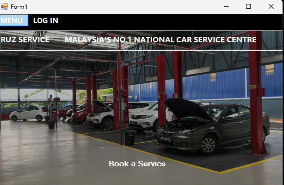
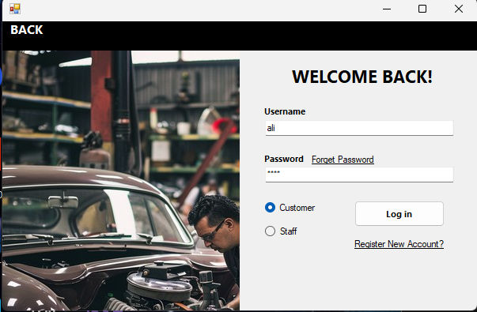
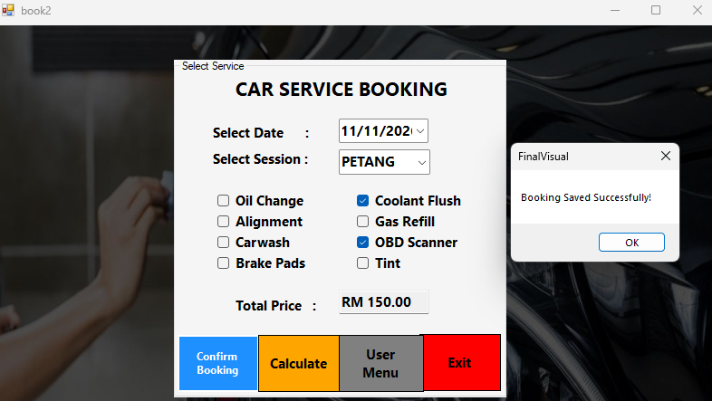
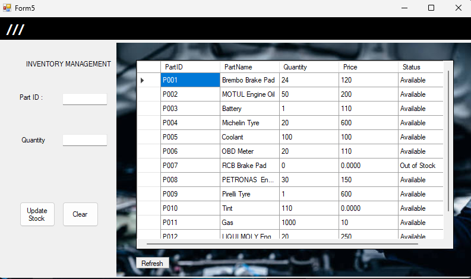
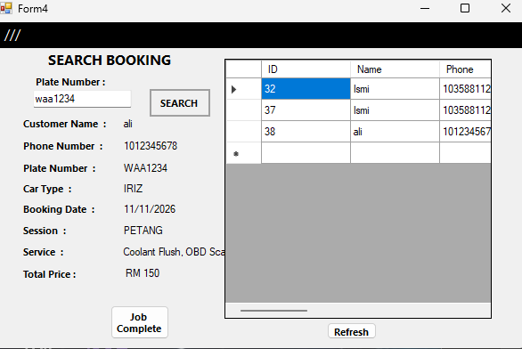

🛠️ Workshop Management System

A Windows desktop application built with VB.NET and Microsoft Access designed to manage automotive workshop operations, customer bookings, vehicle records, and service management.

This project was developed as an academic software group project for the Diploma in Computer Science program at UiTM Kampus Jasin.

📌 Features

🔐 User Authentication & Registration: Secure login and user registration interface for workshop administrators and staff.

📋 Booking & Service Management: Schedule customer vehicle service appointments and log repair statuses.

🗃️ Database CRUD Operations: Real-time Create, Read, Update, and Delete operations for customer records, vehicle information, and service history.

🔍 Search & Record Retrieval: Search customer logs and booking details stored within a local Microsoft Access relational database.

🛠️ Tech Stack & Requirements

Language: Visual Basic .NET (VB.NET)

Framework: .NET Framework / Windows Forms (WinForms)

Database: Microsoft Access (.accdb / OLEDB Engine)

IDE: Microsoft Visual Studio 2017

 ## 📸 Application Showcase

<table>
  <tr>
    <td></td>
    <td></td>
    <td></td>
  </tr>
</table>

<table>
  <tr>
    <td></td>
    <td></td>
  </tr>
</table>
